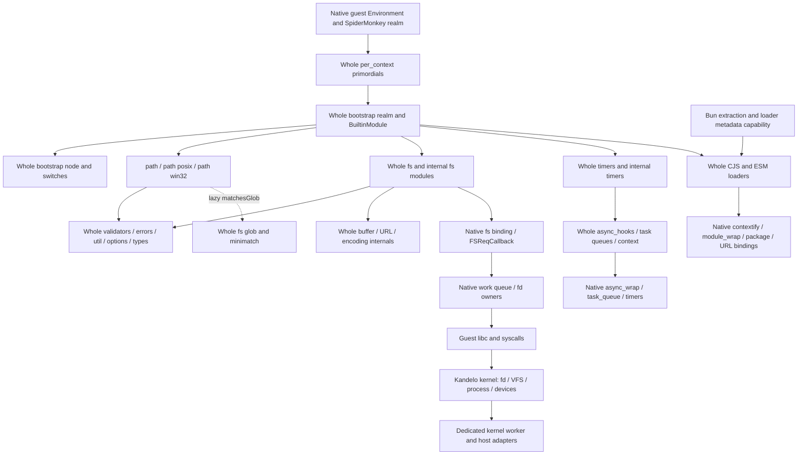

# Whole upstream Node modules on Kandelo

Date: 2026-11-09. **Proposed design, awaiting review. Planning only.**

Execute complete pinned Node JavaScript files, including their internal JavaScript dependencies, in one builtin environment per guest execution environment. Implement the required native binding contracts over SpiderMonkey and Kandelo's guest OS. Replace the public compatibility factories and function-selection machinery as modules migrate. A stored whole file, an exported name, a native helper, or a source-only control is not working module compatibility.

This plan concerns the guest runtime, guest kernel/libc contracts and their Node/browser host adapters. Host Node, browser globals, the Mac filesystem and host credentials do not implement guest Node APIs. The only external reads made for this plan were official Node release/GitHub metadata and the Kandelo preservation branch identity. There are no runtime edits, new runtime tests/probes, builds, ABI changes, merges, releases or deployments.

## Review package and preserved inputs

- [Dependency graph](dependency-graph.json): source paths/hashes, literal and lazy JS edges, binding names/call sites, computed dispatch candidates and upstream C++ registration hints.
- [Module ledger](module-migration.md) and [detailed module dispositions](module-migration.json): all 74 module surfaces from the existing audit.
- [Binding ledger](bindings.md): shared native contract groups and reuse/missing-owner decisions.
- [Pin verification](pin-verification.json) and [input identities](input-identities.json): immutable inputs and new read-only verification results.

Reuse the existing [19-family audit at frozen commit 5f19f5f](https://github.com/Automattic/kandelo/blob/5f19f5f1c61cc80adb8e39e1f8470b497f34e9c8/tests/nodejs/audit/audit-report.md), its requirements, source correspondences, crosswalk, validation catalogs and evidence indexes. The audit retained 11,199 original obligations, 13,292 observations and 74 scoped modules; observations are not unique APIs or a test denominator. All 19 source reviews completed **with gaps**. Keep those IDs and statuses when connecting obligations to new module/binding owners; do not repeat or replace the audit with export discovery.

The frozen workspace is `/Users/brandon/conductor/workspaces/kandelo/davao`, head `5f19f5f1c61cc80adb8e39e1f8470b497f34e9c8`, branch `brandonpayton/node26-core275`, draft PR 1667. Its `.context/node-core-freeze-20261108T220604Z/manifest.json`, sealed source packets, dirty-submodule material, draft PRs and full evidence directory remain authoritative preserved history. No checkout, reset, cherry-pick, stash operation or write there was performed. This planning workspace stays on `brandonpayton/kandelo-node.js-compatibility-plan`; its starting commit is `a3490ca0f48d7c249592925cb7b4ac1ab74b9c2a`. Unrelated `.serena/` is left alone. The frozen implementation is a reuse reference, not a branch to import wholesale.

Bun/npm/Claude preservation is independently anchored by the normal [brandonpayton/bun-auto-unpacking branch](https://github.com/Automattic/kandelo/tree/a9f5d3c115b3d7a1ade2d97ea2aa4b164318de0e), commit `a9f5d3c115b3d7a1ade2d97ea2aa4b164318de0e`. The remote branch was verified at that exact commit. Its original parent is `fe93dbc5e382ccf1e93a8af56b3f9f765a24237c`; reconciliation against current main has not happened. Original stash `7020918631b4696a27af95a51c9aed9a80b8edb9`, stable ref `refs/preservation/bun-auto-unpacking-20261108`, bundle, patch, archive, 39-file manifest and historical logs stay intact. The preservation directory was also copied byte-for-byte into this workspace at `.context/bun-auto-unpacking-preservation/`. Use the normal commit as primary source; backups do not become a new implementation branch.

ABI55 fixtures, measurements and admission history stay immutable. Current main's successor baseline and any file-advice activation are separate platform work. Full product builds, successor-ABI rebuilds and full expanded suites remain deferred. Historical build products were cleaned up in davao; an old successful log does not imply an artifact still exists or validates this plan.

## Pin verification and discrepancies

On November 9, read the official [release index](https://nodejs.org/dist/index.json), [v26.13.0 release](https://github.com/nodejs/node/releases/tag/v26.13.0), [tag reference](https://api.github.com/repos/nodejs/node/git/ref/tags/v26.13.0), annotated tag object and [commit](https://github.com/nodejs/node/commit/18b32a3b1552e199a01f1a8d9fd64aa756d3b75b). The recorded version **26.13.0**, date **2026-10-28**, LTS name **Lithium** and source commit **18b32a3b1552e199a01f1a8d9fd64aa756d3b75b** agree. The tag is annotated: object `daaa22aeddb87085542376ea1f4854dcea080baf` peels to the recorded commit; the tag-object SHA is not a source-commit discrepancy. The frozen `third_party/node-core/sources.json` agrees with `target.json`.

All five hashes match the official [SHASUMS256.txt](https://nodejs.org/dist/v26.13.0/SHASUMS256.txt):

| Recorded archive | SHA-256 |
|---|---|
| source `.tar.gz` | `986ead18ef18256831bae3e57d94aef680a7b84cfd4044f3e8471f833fbd7191` |
| darwin-arm64 | `d38bd5e5a2ddce6bbb5ce45e46e208337da4d51fffe611e567fd32073d6439f6` |
| darwin-x64 | `525c9b29bb0263d687de60a4cec0e2a6db876a8eb032369e5795eca71e7c358e` |
| linux-arm64 | `439e9c438acdf6a6ffe47418da709153d66c4bed812e30a473faacb107dd2791` |
| linux-x64 | `5848553868b402d3fabb5b09270649977780a390f832155721025a08b5104455` |

Rehashed the existing source and Darwin-arm64 archives and extracted Darwin-arm64 `bin/node`; they match the recorded identities. The executable hash remains `533bd644c5ae0e0ea3a80e433aad16b817447ccba1e1eea701875eac80cb75d4`. No native executable was run. The other three native archive pins were checked against official metadata, not freshly downloaded or executed. These checks compare HTTPS official records; no new signature-chain verification is claimed. Raw responses are saved in this workspace's `.context/node-core-module-plan/`.

**No recorded Node target/source/native pin inconsistency was found.** Relevant baseline differences remain explicit:

- The audit's `target-pins.md` describes its then-current source revision 45; the frozen restart head is later. That text is historical, not validation of source275 or this design. Earlier accepted engine271 compilation and other controls keep their own identities.
- This main-based workspace predates the frozen Node26 import: it has no `packages/registry/node-compat/target.json` or `third_party/node-core/`. Its SpiderMonkey recipe still depends on OpenSSL 3.3.2/zlib 1.3.1/libzstd 1.5.6, whereas the frozen recipe names OpenSSL 3.5.9 and Node26-specific dependency packages. The official Node26 index records OpenSSL 3.5.9, libuv 1.52.1, zlib 1.3.2.1-motley and native module ABI 147. Do not silently mix the older dependencies with the new module source, advertise ABI147 for SpiderMonkey addons, or copy the frozen ABI55 package settings onto the successor platform. Dependency reconciliation needs separate review.
- Development-shell Node24 is tooling, not an exact native Node26 control. SpiderMonkey ESR 140.11.0esr is the engine source, not the Node source pin. A guest compatibility target is not evidence that V8, its snapshots or its native binary ABI are implemented.

No target, source, native reference, package dependency or `verifiedOn` field was changed.

## Module and binding graph

The static graph inventories **443 files**: 427 `lib/**/*.js` files and 16 dependency payloads selected from `node.gyp`/`configure.py` (including Acorn, minimatch, Undici, Amaro and V8 tooling). Every inventoried file was compared byte-for-byte by SHA-256 with the locally cached source archive whose checksum matches the official release. This imports no code into the runtime.

It records **3,327 literal/lazy dependency sites** and **72 literal binding names**. All literal JS targets, including 11 static import edges in dependency `.mjs` files, resolve within that inventory. Native registration records identify upstream reference owners, not completed Kandelo implementations. `resolved: true` on a binding edge denotes a named graph endpoint, not an implemented binding. Builtin IDs follow `tools/js2c.cc`: `lib/x.js` becomes `x`, dependency payloads become `internal/deps/...`.

This is a conservative **source graph**, not a startup trace, eager-closure proof or parser-complete dependency analysis. Literal-call scanning skips comments and treats strings/templates as opaque; dependency `.mjs` static import-from declarations are inventoried separately; template substitutions, regex syntax, runtime-selected names, native callbacks and registration tables require explicit review. The 21 computed-dispatch/declaration candidates are retained with snippets; some are dispatcher definitions rather than executed calls. Important dynamic edges include cluster child/primary selection, builtin-name lookup, test/bench reporters, worker deserializers and user CJS/ESM specifiers. They must resolve through the same registry. Literal closure from `path`, `fs` or `timers` reaches 285 files/65 binding names when **all lazy/conditional branches** are included; that is not a claim that all are required at startup or implemented in the first slice.

Representative exact edges from the pinned source:

| Module | Direct dependencies and important deferred edges |
|---|---|
| `path` | `internal/constants`, `internal/validators`, `internal/util`; lazy `internal/fs/glob` for `matchesGlob`. `path/posix` and `path/win32` return properties of the same cached `path` exports. |
| `internal/validators` | `internal/errors`, `internal/util`, `internal/util/types`, native `constants`. |
| `internal/util` | Native `constants`, `util`, `types`, `string_decoder`; `internal/errors/options/assert`; lazy `uv`, messaging, VM, profiler, warnings, source maps. |
| `fs` | Native `fs/constants`; whole `buffer`, path, URL, validators, fs utils, permission state. Lazy Dir, streams, read context, glob, cp/rimraf, watchers, Blob and promises remain whole files. |
| `fs/promises` | Whole `internal/fs/promises` and its exported object; no handwritten promisification replacement. Enabled public Node VFS remains distinct from Kandelo kernel VFS. |
| `timers` | Native `timers`; whole linkedlist/internal timers/util/debuglog/validators/async_hooks; lazy timers/promises. |
| `internal/timers` | Native `timers/task_queue`; whole async_hooks, validators/errors, priority queue, inspect, async-context frame. |
| `internal/bootstrap/realm` | Native `builtins/module_wrap/errors`; shared policy, internal/public cache and ESM facade ownership; special self module and legacy processbinding. |
| `internal/bootstrap/node` | Native config/util/process_methods/credentials/async_wrap/timers/trace_events/errors/buffer; task queues, events, Buffer, transfer setup, execution/warnings/options and source maps. |

The source graph is cyclic. In particular errors/util/validators and public/internal modules cannot be topologically replaced one function at a time. Order **capability and bootstrap initialization**, preserve cycle-aware module records, and activate coherent groups.

## One loader and bootstrap environment

### Source packaging and compilation

After approval, create a versioned source manifest recording complete upstream relative paths, source archive/commit, SHA-256, licenses and an explicit patch list. Use the same source tree for public and internal modules and dependency payloads. Preserve Node license and bundled dependency licenses. Packaging may encode bytes and wrap complete files in factories; it must not select functions, inject alternate local `require()` implementations, rewrite algorithms or run string replacements. Do not use the old `build.py` to manufacture the new graph.

Implement `internalBinding('builtins')` over the immutable source table: `builtinIds`, `compileFunction`, `setInternalLoaders` and the other actually consumed members. Compile builtins with the pinned six-argument order `(exports, require, module, process, internalBinding, primordials)` and source origins. Compile per-context/bootstrap entries with their own upstream wrapper arguments, including private/per-isolate symbols where required; they are not ordinary user CJS. Embedding-supplied globals and argument lists must be inventoried before executing each bootstrap file. Preserve full-source identities separately from wrapper/patch/generated artifact identities.

Start with source compilation. XDR/stencil caching is a later optimization, keyed by engine build, source and patches, options and realm constraints. Never ingest V8 code cache/snapshot bytes as SpiderMonkey artifacts.

### Bootstrap sequence and state ownership

1. Create one native guest Environment per main/worker execution context; initialize its realm, work/completion queues, async roots, process owner, options, actual guest state and binding registry. Registry definitions can be shared across environments, but realm objects/caches cannot. VM-created realms get the per-context initialization required by their mode, not an automatic second full process.
2. Provide the engine hooks Node captures before primordials run: actual stack capture/formatting, intrinsic brands, GC-safe native callbacks and private storage. Evaluate the **whole** `internal/per_context/primordials.js` before user code. Share its one resulting object among that realm's builtins. Do not regenerate a partial primordial dictionary per adapter. Finish required whole per-context files such as DOMException with the correct native slots and argument lists.
3. Evaluate whole `internal/bootstrap/realm.js`, providing native process, linked/internal-binding entrypoints and primordials. Let its `BuiltinModule` own builtin records, public exposure policy, `process.binding` allowlist, `moduleLoadList`, loading flags and CJS/ESM facades. Native seed services must not require an unbootstrapped JS error module in order to create themselves.
4. Evaluate whole `internal/bootstrap/node.js` and the appropriate process-state/main-thread or worker switches. Native process methods read/mutate **guest** cwd, env, credentials, fd/stdio, signals and lifetime. Install the upstream task queue, timer dispatch, fatal/rejection handling, transfer registration and lazy globals once. Native bootstrap supplies initial process fields; the old public `process` facade does not run alongside it.
5. Use whole `internal/process/pre_execution`, the selected `internal/main/*` entry and whole CJS/ESM loaders for normal user execution. Their contextify/module_wrap/package/URL/options prerequisites are real work. The first proof may use a native builtin-entry driver to exercise builtins after bootstrap, but that driver cannot stand in for a validated Node CLI, package resolver or user loader. Exact CJS/ESM builtin identity must still be demonstrated through both bridges before accepting the slice.
6. Drive the shared guest loop until actual referenced work is exhausted, with beforeExit/exit/fatal state and teardown. Do not equate an empty SpiderMonkey Promise-job queue with a finished Node process.

A missing eager bootstrap member blocks activation; do not skip the corresponding line of `bootstrap/node.js`, fabricate a native success, or change its feature flags merely to get `path` running. Real non-snapshot execution may report that no snapshot is being built; that is valid state. Disabled optional features must have truthful config and the upstream disabled path, with enabled cases still open in the audit.

### Cache, cycles and public CJS/ESM identity

Use upstream `BuiltinModule` loading/loaded state and partial exports during cycles. Its failure behavior is authoritative: the pinned internal loader clears `loading` in `finally`, marks `loaded` only on success and retains its module record. Do not apply user CJS cache-rollback rules to builtin records. User CJS failure eviction, parent/child relations, wrapper receiver and ESM failed evaluation remain owned by their respective whole loaders.

Normalize `node:` only through the public builtin policy. `require('fs')`, `require('node:fs')`, `process.getBuiltinModule` and the ESM builtin facade reach one exports owner; `fs/promises` equals `fs.promises`, `path/posix` equals `path.posix`. Keep the user CJS cache, builtin record map and engine ESM module map distinct but coordinated. Preserve public CJS cache-shadowing behavior; the `node:` path still uses the builtin registry. Implement `syncBuiltinESMExports` via native ModuleWrap synthetic exports and the upstream sync path; do not build constant snapshot namespaces by enumerating `Object.keys()` into generated ESM strings.

Native `module_wrap` must provide real module records, linking, cycles, live bindings, TLA, evaluation errors and synthetic exports on SpiderMonkey. Native `contextify` must provide actual function/script compilation, origin, context and import callbacks. `process.binding` and `_linkedBinding` are separate, policy-controlled compatibility entrypoints; never expose unrestricted `internalBinding` to ordinary user modules. `internal/test/binding` remains subject to the upstream internal-exposure option. No fallback to an outer host `require()` is permitted.

User resolution retains Node CJS versus ESM differences: guest package imports/exports/conditions, JSON attributes/BOM, file URLs/query/fragment, `data:` policy, source maps, formats, flags, hooks and cache identity. Preserve audit L-030/FS-021 source-versus-documentation questions until exact native controls are authorized. Do not choose a convenient interpretation or adjust the pin.

### Native bindings and asynchronous completion

Implement native registration under Node's actual `internalBinding` names. Return stable per-environment binding objects and actual JSAPI host objects, typed arrays and functions, including required descriptors, constructor brands, symbols and receiver checks. C++ names or one-op syscalls do not by themselves match those contracts. The native registry lives below upstream modules; shared native objects and callback-scope code replace repeated per-module JS substitutes.

For `fs`, implement the overloads consumed by the complete file: synchronous calls return/throw in the native Node shape; callback calls adopt the actual `FSReqCallback`, preserve async id/trigger/frame and later invoke `req.oncomplete` with exact errors/results. Promise/FileHandle/Dir requests remain separate types for subsequent activation. Map guest errno/flags/paths to target Node error properties and actual guest constants; do not use Darwin or Linux flag numbers on the guest. Native Buffer, URL, string decoding and raw path ownership must agree across every module.

A worker thread executes only native guest libc/kernel operations. It never reads JS values, manipulates GC roots or calls JS. Completion returns to the owning JS context, establishes the native async callback scope, restores context, releases pins/roots/requests exactly once even on throws, and runs the upstream task-queue/microtask/rejection policy. Cancellation distinguishes queued cancellation, running operation completion and environment shutdown. Shutdown joins or terminally interrupts native owners before memory/context retirement. An async API is not implemented by doing synchronous I/O then scheduling its callback.

`timers` binds actual monotonic time, timer scheduling, immediate/check processing, shared ref counts and callbacks installed by upstream bootstrap. `task_queue` bridges nextTick state, Promise jobs, rejection notifications and microtask callbacks; `async_wrap` exposes the real aliased state and hook dispatch, not copied counters synchronized after arbitrary JS. Reuse native owners only after matching these exact layouts and lifecycle semantics. Do not promise a fixed order between unrelated I/O and timers where the native target does not guarantee one.

## Upstream patches and missing prerequisites

**Default: no upstream public algorithm changes.** No patch was created in this planning phase. Most old edits should disappear behind real bindings. There is one concrete small engine-adaptation class that cannot be replaced by an ordinary JS Symbol:

| ID | Complete source and proposed minimal adaptation | Why / alternatives / obligations |
|---|---|---|
| P1 | `lib/internal/per_context/domexception.js`: its two writes to `transfer_mode_private_symbol`; `lib/internal/worker/js_transferable.js`: its `obj[transfer_mode_private_symbol] = mode` write. Route only these writes to a native hidden-slot setter if the chosen SpiderMonkey embedding has no V8-private-key property operation. Keep the entire files. | Node uses non-reflectable native private storage. An ordinary Symbol leaks through reflection and has different proxy/brand behavior. Existing generator already adapts the DOMException sites, but must not be imported wholesale. Alternative: a reviewed engine private-key mechanism that executes the original syntax correctly. Check all other private-key reads/writes before declaring P1 complete. Future controls must cover reflection, proxies, cross-realm access, clone/transfer tags and failure/GC behavior. |

P1 is unavoidable **under the hidden-slot binding design**, not a claimed engine defect or a license to patch public behavior. Prefer an existing correct native private-key mechanism if review establishes one. Every additional adaptation needs exact source hash/range, tiny diff, owning boundary, alternatives rejected, semantic obligations, four-host evidence and replay/removal criteria. Source and patched hashes stay distinct. Review any expansion of this patch list before implementation continues.

Existing assertion stack edits should be replaced by an actual native `Error.captureStackTrace`/stack preparation bridge before primordials capture it. Keep complete internal error/inspection/source-expression modules; do not retain the selected Acorn tokenizer assembly. Existing AsyncHook count-publication edits indicate a missing true native aliased-state binding; implement that contract instead of silently retaining text insertion. Existing public timer/Buffer/FS/event selections, local `require()` switches and fake dependencies are not exceptions to the whole-module rule.

Missing prerequisites remain explicit: complete builtin compilation/ModuleWrap and bootstrap hooks; shared errors/stack/inspection, options and symbols; real Buffer/storage/encoding/URL/Intl bindings; native async/tick/Promise/timer layout; process/env/stdio and startup switches; fs binding members required at eager initialization. Lazy streams/Dir/watch/VFS/ZIP/native integrations and actual protocol/worker backends remain deferred activation work. Shared/resizable/detached storage, raw invalid-UTF8 path handling, nested guest Wasm/Amaro, addon ABI, V8 binary formats and host-specific facilities need individual dispositions. A missing binding is an implementation gap, not proof the browser or engine cannot support its public API.

## Migration dispositions across the 19 families

Use four independent labels: **N** reusable native foundation candidate; **R** public implementation/dependency assembly to replace; **E** test/audit/evidence to retain; **S** separate platform/dependency capability. A file may contain more than one category; preserve useful native algorithms without importing its facade. All N entries require source/dependency identity, binding-contract review and later actual-engine validation. All rows retain E; none is a compatibility pass.

| Family | N: reuse candidates | R: execute whole upstream owners | S: separate prerequisites / retained audit questions |
|---|---|---|---|
| values | Native Buffer/backing/string bytes, brands, stack/inspection and ICU4X hooks | buffer, assert, path, util/types/inspect, URL, codecs and legacy aliases | Shared/resizable storage, exact Node ICU correspondence, complete stack/source bridge |
| async | Native async IDs/frames/default trigger/callback scope; Promise and timer loop hooks | events, async_hooks, timers, diagnostics_channel, domain and shared internals | Fatal/rejection policy, true aliased state, native lifecycle integration |
| streams | Native byte spans, fd/stream completion and ownership | stream family plus internal streams; shared Web Streams modules | Ports/transfers, stdio/backpressure and owner cleanup |
| filesystem | Native work queue, requests, fd/FileHandle leases, read/write/stat/directory/copy owners | fs, fs/promises and all reached internal fs files | Raw-byte paths FS-022, mounts/metadata, watch notifications, file advice/ABI, enabled public VFS |
| processes | Real guest process/spawn/wait/pipe/env/signal/OS owners | process bootstrap, child_process, cluster, os, DotEnv internals | Kernel accounting/credentials/permissions, IPC/fd passing; preserve exact target maxBuffer behavior |
| network | Socket/listener/accept/UDP owners, DNS lookup and real record channels | net, dns/promises, dgram, rules/address internals | Actual backend controls/budgets, DNS service ownership, host capability differences |
| http | llhttp/parser/native socket lifetime | http/https, `_http_*`, Agent/server/framing; http2 wrappers | HTTP2 native protocol/flow control and complete TLS/server integration |
| secure-network | libssl/native TLS context/credentials/shutdown | tls, `_tls_*`, dtls/quic JS and internals | OpenSSL reconciliation, real trust/metadata/server; UDP/DTLS/QUIC protocol engines |
| crypto | Entropy/hash/key/KDF/cipher/signature/X509/ncrypto native owners | crypto and internal crypto/WebCrypto modules | Real entropy quotas/failure, provider/FIPS capabilities and byte/async ownership |
| web | Native encoding/URL/ICU, Blob storage, ports and clone owners | WebIDL, Blob/File/FormData, Fetch/Undici, Web Streams, Abort/EventTarget | Real transfer/worker/HTTP/TLS owners, URLPattern/Intl and enabled features |
| loading | SpiderMonkey realm/stencil/module record/import/package parser hooks | module, CJS/ESM/helpers/package/source-map/CLI internals | Compiler/cache/hooks/TS parser and Node package-map conflict; retain engine origin controls |
| terminal | Native tty read/write/modes, PTY and fd owners | tty, readline/promises, REPL and internal editing/history | Actual device/stdio/session lifetimes; REPL ALS/exception integration |
| workers | Independent worker, backing/port/clone/transit/lock owners | worker_threads and internal worker modules | Ready/error/exit/ref teardown, structured transfer and complete child environments |
| compression | Native codec handles, actual libraries and shared work pool | zlib, iterators/ZIP/internal codecs | Library identity/options, cancellation/GC/flush, ZIP fs/storage disposal |
| observability | Native histogram/clock/sampler/tracing producers | console, perf_hooks, reports, trace_events and internals | Complete real measurements, observer delivery, report schema; no invented V8 statistics |
| engine | VM context/stencil/module/Debugger/deadline hooks | vm, inspector, v8 JS wrappers and internals | Engine-specific formats/coverage/debugger protocols need explicit boundaries |
| testing | Shared worker/process/diagnostics/native instrumentation | test/bench runners/reporters, mocks/hooks/coverage internals | Actual CLI isolation and coverage providers; no test-only dependencies in production |
| native-integration | FFI memory/library, SQLite, WASI and SEA asset owners | ffi/sqlite/wasi/sea and full internal wrappers | Node-API/embedding/loader/ABI admission, native ISA and V8 snapshot formats |
| documentation | Existing option/warning/provenance ownership | Whole normal warning/deprecation/activation owners | Keep removed/gated APIs and narrative requirements; no facade-based export score |

Concrete retirement targets are the handwritten public objects in `packages/registry/node-compat/bootstrap.js`, `_createNode*` public wrappers with module-local dependencies, selected source blocks in `third_party/node-core/build.py`, and ESM namespace string synthesis. Retain old source in frozen history. Delete active replacements only when the new owner passes its focused acceptance; never remove evidence because its implementation is superseded. Native `.cpp/.h` reuse is selective: copy the owner with needed license/provenance and dependencies, translate its entrypoints into the shared binding registry and review its JSAPI/lifetime contracts. A filename beginning `native-` is not proof of correctness.

## First vertical slice proposed for approval

Proposed first implementation PR: **Node: Execute upstream path, fs and timers**. Its purpose is to prove the common environment and real binding path, not complete these families or make Claude work. Do not start it under this planning authorization.

| Path through whole public modules | Required behavior | Required native owner |
|---|---|---|
| `node:path`, `node:path/posix`, `node:path/win32` | Portable join/resolve/normalize/validation; alias identity; `path.win32` stays a portable algorithm on the real guest platform | Whole constants/validators/util/errors/options/types and actual guest cwd/env; lazy glob remains a tracked dependency |
| `node:fs.openSync` then `closeSync` | Open a real guest fixture and close the real fd; missing path/invalid fd/permission errors and guest side effects | `internalBinding('fs').open/close`, guest flags/constants, path/URL/Buffer conversion, libc/kernel fd/VFS |
| `node:fs.open` then `close` callbacks | Native work is queued; completion occurs later on the owning JS thread, exactly once, with correct async resource/error/cleanup | Real FSReqCallback, shared work pool, async_wrap and callback scope |
| `node:timers.setTimeout`/clearTimeout and setImmediate | Actual time/deferred execution/cancellation/ref-unref/disposal, nextTick/Promise interaction; no exact race order invented | `timers`, `task_queue`, async_wrap/context and real loop wakeup/ref state |

These selected calls are acceptance scenarios; the public files are still loaded and executed **whole**. They do not authorize extracting just open/close or recreating a tiny path/errors module. Preserve full lazy dependencies in the source manifest. Track unsupported reachable operations precisely; never publish a partial `fs` as complete. A lazy feature may remain unavailable through truthful binding/capability failure, but an eager binding member needed to initialize the file cannot be replaced by a success stub.

Ordered implementation work, subject to review:

1. Reconcile the exact source import and required native dependency recipes against current main without changing pins or importing the frozen branch. Produce the precise eager bootstrap/member checklist from this conservative graph. If it exceeds the agreed slice, return the expanded dependency set for review; do not prune upstream code to fit a budget.
2. Add whole-source packaging and manifest plus the native builtins registry, compiler wrappers, shared primordials and realm bootstrap. Implement the minimal real `module_wrap` synthetic-module bridge required by realm initialization, builtin ESM exposure and live-export synchronization. Reuse actual SpiderMonkey module records; do not postpone this with generated namespace strings.
3. Supply all eager node/bootstrap contracts: native process seed, truthful config/options, shared errors/brands/bytes, task queue/async/timer state, transfer/private slots and the correct startup switches. Use upstream disabled/snapshot-free paths only when they reflect actual configuration. Record any approved P1 application and patched hashes explicitly.
4. Translate selected native fd/open/close/work/callback owners into the single fs binding. Prefer existing guest owners after reviewing exact Node binding overloads and failure semantics. Keep native kernel/host/ABI changes in separately reviewable platform work; do not import successor file-advice activation.
5. Exercise the four paths above through public CJS and ESM builtin exposure, including cycle/alias/cache/descriptor/live-export and failing-initialization cases. Retain whole user loaders as the target design. If only a native builtin-entry driver is ready, label that intermediate evidence and leave CLI/package-loader acceptance open.
6. After separately approved targeted artifact preparation, obtain native exact-pin controls and identified guest results on Node, Chromium, Firefox and WebKit. Report emitted source/patch/dependency/engine/program-ABI digests, test fixtures, options and selected cases. Do not claim product readiness from this slice. Stop for review before expanding activation or increasing build scope.

Likely implementation locations (proposed, not created): a versioned whole-source manifest/table under `third_party/node-core/`; shared embedding registration/bootstrap/compiler glue and native binding owners included by the SpiderMonkey package; updated `packages/registry/node-compat/bootstrap.js` entry routing; focused package integration fixtures under `packages/registry/spidermonkey/test/`; existing Node source/native differential tooling and audit crosswalks. Package build metadata must be reconciled through its normal owner. No test-only module loader may become the production path.

Later acceptance must retain unchanged upstream assertions and exact native comparisons for path algorithms/validation, fs fd/errors and callback timing, timer cancellation/ref/disposal, primordial tampering, builtin alias/cycle/live ESM behavior, root/pin lifetime, thrown callbacks, queue shutdown and no-callback-after-environment-retirement. Include fixture closure and nonpassing/skip/unsupported/timeout/harness-error accounting. Only assert ordering the exact target guarantees. New tests are **described here, not written or run**. Any kernel/fd/ABI or host-lifecycle work additionally needs the appropriate POSIX/libc/conformance/lifecycle suites at an authorized milestone; unit or source controls cannot replace them.

## Subsequent migration order and evidence

Wave 0 is this review and source/binding ownership decisions. Wave 1 is the shared environment and first vertical slice above. Wave 2 expands whole value/stream/filesystem/process/worker/loading groups on the shared native foundations. Wave 3 activates transport/DNS, HTTP/TLS/crypto, codecs/ZIP and Fetch consumers after their owners exist. Wave 4 covers terminal refinements, real diagnostics/instrumentation, engine/testing/native integration and remaining feature-gated protocols. Cycles and actual dependencies can move work earlier; a wave number does not permit a substitute dependency. The per-module ledger gives exact source routes and native candidates.

Retain the audit's historical initial 5,147-case selection per host as recorded: 3 pass, 3,721 fail, 1,423 unsupported, including 3,687 failures per host at a shared net accessor. Those are historical failures and selection limits, not current independent diagnoses or passing coverage. Preserve later selected/interrupted runs independently, including the unresolved Firefox exit-fixture timeout. Never replace a nonpass with an exclusion without an operation-specific reviewed boundary.

After a module migrates, connect each retained requirement to its new whole-file/native owner and later evidence identity. Keep inventory/source-review/implementation/runtime-conformance dimensions separate. Start later integration validation with the previously requested Firefox fixture and affected networking/retained failures when those owners change; do not introduce an arbitrary 500-case sample or combine older source controls into current four-host support. Broader suites and canonical products need an explicit later milestone.

## Separate Bun extraction and loader capability

Retain the complete 39-file preservation scope independently of Node-core replacement: `programs/bun-extract.c`, `programs/bun-run.c`, `runtime/bun-run/`, `packages/registry/bun-run/`, `node-browser-bundle`/`node.zip` wiring, image/runtime installation, generic extraction/launch/cache fixtures, npm lifecycle and Claude evidence, and the browser CORS relay changes. Keep original attribution, source modes and commit identity. Do not drop any of these as obsolete Node-adapter code.

The branch's runner currently publishes `__kandeloAssetLoaders`, installs Bun globals/`__breq`, rewrites app argv and imports the prepared entry. The integration design replaces that ambient loader coupling with an **explicit extracted-bundle capability** passed to the common user loader. It does not change Node public `fs`, `module`, `Buffer` or core builtin resolution.

| Stage | Preserved behavior and proposed loader boundary |
|---|---|
| Prepare | Explicit bun-run launch invokes the real guest extractor, validates the input, uses the private uid-owned cache, POSIX lock and atomic completion manifest. Cache hits retain source/content identity. Extraction remains a guest operation. |
| Register | Validate the completed manifest/version/root/relative module and asset paths before creating a scoped bundle descriptor. Preserve recorded loader kinds, entry, files and cache origin. Do not let package metadata shadow `node:` or private internal IDs. Missing/older manifests currently fall back to ordinary loading; preserve that as a versioned legacy route until its behavior is reviewed, not as an inferred asset mapping. |
| Resolve | The bundle's explicit resolver runs only for its own module graph/cache paths. Normalize file URLs using the common URL/path owner; reject path escape/unknown kinds and respect actual symlink/realpath identity. Ordinary Node packages continue through the upstream resolver. Resolve and load remain separate operations. |
| Load | JavaScript goes to the normal CJS/ESM compiler/module records. JSON goes through a documented bundle loader preserving Bun's expected value and cache behavior. Text returns decoded text, file assets return the prepared guest file path, and native-addon payloads produce the existing explicit unsupported error. Do not infer loader kind solely from extension or execute CPU-native code. |
| Cache and namespaces | Preserve per-file loader metadata in identity: canonical guest URL, bundle content identity and loader kind. Coordinate extracted JSON/CJS/ESM values through the common user module map, without a second builtin map. Keep text/file custom formats isolated to the bundle capability; exact ESM namespace semantics need focused integration checks. |
| App environment | Install the retained Bun shim only for explicit bun-run execution, with app argv and entry metadata. `__breq` must resolve relative to the bundle/caller context, not inherit bun-run.js's unrelated base. Preserve `Bun.main/isStandaloneExecutable`, supported assets and truthful unsupported controls. Expose the actual guest architecture. |
| Lifetime | Scope bundle descriptors, file roots, loader maps and compiled records to the environment; roll back failed extraction/registration, preserve cache locking, and retire callbacks/owners on exit. Cache files retain their original explicit lifecycle; reboot clears tmpfs. |

This capability depends on the common user loader, URL/JSON/Buffer/FS, child_process and package wiring, so it is **a separate integration PR after the module environment is ready**, not part of the first builtin slice. Prefer a shared native loader hook or upstream public customization-hook route once implemented. If a small loader integration patch is actually required, present its exact boundary/diff for review; do not mutate Node builtin algorithms or restore a per-module fake require. Preserve existing CORS/npm/browser changes on their branch for separate reconciliation.

Later acceptance reuses generic synthetic fixtures first: extraction cold/warm/locking/failure, all embedded loader classes, argv, CJS/ESM relative/dynamic imports and builtin identity, text/file/JSON values, native-addon rejection, cache origin/permissions and npm lifecycle. Real Claude version/help and application/network checks remain separately identified historical/future evidence. Neither extraction nor those selected app results establish complete Bun APIs, native machine-code support or complete Claude behavior.

## Planning verification

Parsed the four JSON deliverables and checked the 74-module ledger against the frozen audit, all 19 family report identities, the 72 binding names against the binding ledger, local document links and documentation whitespace. The source graph includes 3,327 dependency sites (11 are static dependency-payload imports); every inventoried source file matches the verified source archive. Rechecked the frozen input hashes, head and stable preservation ref. All 39 Bun remainder files match the primary commit by SHA-256 and Git mode; all preservation-directory copies match the original bytes. These are documentation/source/preservation checks only. No target JavaScript or native executable was executed, and no new runtime test/probe, compilation or build ran. No runtime or four-host result is claimed.

## Stopping point

This deliverable is source research and documentation only. No implementation is authorized by the proposed PRs or acceptance checks. Review the shared environment/patch policy, native contract boundaries and first-slice scope before any runtime edits, new runtime tests/probes or builds. Full product and successor-ABI rebuilds remain deferred; preserve davao, all existing PRs/evidence, Bun/npm/Claude work, unrelated changes and ABI55 history. Do not merge, release or deploy.
